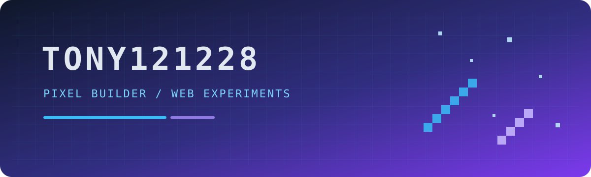

<h1 align="center">Tony121228</h1>

<strong>PIXEL BUILDER · WEB EXPERIMENTS · SMALL TOOLS</strong>

正在把想法做成可以打开、可以使用的小东西。

---

## NOW

Web 项目、界面实验，以及一些有趣的小工具。

## SELECTED WORKS

### [hot-meme-dict](https://github.com/Tony121228/hot-meme-dict)
一个热梗搜集整理功能网站。

### [InkEdge](https://github.com/Tony121228/InkEdge)
一个 Web 项目实验。

## TOOLBOX

HTML · CSS · JavaScript · GitHub

## LINKS

[GitHub](https://github.com/Tony121228)

把想法做成可以打开、可以使用的小东西。
